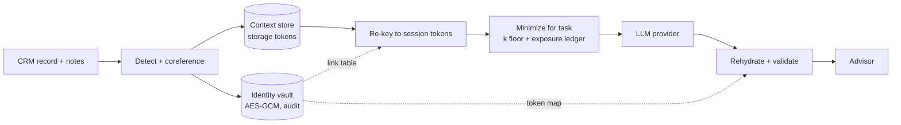

# secure-context

Giving AI client context without exposing client data (DSI industry project p040 with LPL Financial).

An advisor's AI assistant is more useful when it knows the client's goals, holdings and history, but sending the full client file to a model provider exposes far more than the task needs. This repo builds and evaluates a privacy-preserving context layer:

1. **Detect** identifiers in structured fields and free-text advisor notes.
2. **Split storage**: identity in an encrypted vault, financial context in a separate store, joined only through a link table inside the vault (random UUID keys, so primary keys reveal nothing).
3. **Dehydrate**: replace identifiers with session-keyed HMAC tokens. Tokens change every session, so AI logs cannot be linked across sessions.
4. **Minimize**: for each task, send only the detail it needs (age band instead of age, sector weights instead of tickers). The adaptive minimizer searches, per client, for the most useful context whose crowd size k stays above a floor.
5. **Track cumulative exposure**: a ledger merges everything already revealed about a client, because a provider can link requests by content even when tokens rotate.
6. **Rehydrate** the model's answer for the advisor and flag tokens it cannot resolve.
7. **Attack it**: key lookups, cross-session linkage, hash brute force, quasi-identifier linkage against a 50,000-person directory, attribute inference, and extraction of a planted proprietary strategy.

## Data

LPL client data is not available, so the evaluation runs on public datasets, each covering one layer of the system. Names, SSNs, accounts and contact details are always generated, never real.

| Layer | Dataset | Size | License | Used for |
|---|---|---|---|---|
| Client profiles | [Finance-Agentic-AI/Financial-Advisory-Clients](https://hf.co/datasets/Finance-Agentic-AI/Financial-Advisory-Clients) | 5,000 clients | MIT | age, income, marital status, dependents, portfolio value, goal, horizon, risk tolerance, topics discussed, recommended products |
| Population directory | [Census ACS PUMS 2023, 1-year](https://www.census.gov/programs-surveys/acs/microdata.html) (NY, NJ, CA, TX, FL, IL) | 978,284 adults | public domain | real age, state, local area (PUMA), occupation and income; the attacker's reference data for re-identification |
| Wealth and portfolios | [Federal Reserve SCF 2022](https://www.federalreserve.gov/econres/scf_2022.htm) summary extract | 22,975 records | public domain | financial assets and portfolio mix, matched to each directory person by age, income and occupation |
| Request types | [bitext/Bitext-wealth-management-llm-chatbot-training-dataset](https://hf.co/datasets/bitext/Bitext-wealth-management-llm-chatbot-training-dataset) | 23,806 requests, 24 intents | CDLA-Sharing-1.0 | which client context each kind of request needs; realistic request text |
| PII documents | [gretelai/synthetic_pii_finance_multilingual](https://hf.co/datasets/gretelai/synthetic_pii_finance_multilingual) (English test split) | 2,891 documents | Apache 2.0 | PII detection benchmark written by a third party |

Each Advisory client is placed on a Census person with the same age, marital status and similar income, so every client exists in the directory with a real location and occupation. A fully synthetic environment (`secure_context/data.py`) is kept for tests and as a fallback.

```bash
python3 scripts/download_data.py   # downloads everything into data/ (about 250 MB, stdlib only)
python3 eval/run_real.py           # every metric on the public datasets -> eval/results_real/
python3 eval/run_all.py            # same metrics on the fully synthetic environment -> eval/results/
```

`data/sample/` holds a small committed extract (150K Census rows, SCF, Advisory clients) so the hosted app runs on public data without downloading.

## Metrics

| Question from the brief | Metric |
|---|---|
| Can a client be identified from what the AI sees? | crowd size k (directory entries matching everything disclosed), % unique, % with k < 10 |
| Does exposure accumulate across interactions? | cumulative k after N requests, under the real request mix |
| Can hidden attributes be inferred? | attacker accuracy vs. majority-guess baseline |
| Is personal data caught before it leaves? | direct-identifier span recall, precision, % of documents with a leak |
| Can primary keys or tokens be used to look people up? | pass/fail per key-based attack, brute-force time |
| Can institutional IP be reconstructed? | surrogate error and rule recovery vs. number of queries, cost to honest users |
| Does the AI stay useful? | task utility (0 to 1) vs. full context, needs covered, refusal rate |
| Other channels | transaction unicity, advisor-query exposure, k against the firm's own book, policy side channel, uniqueness of exact amounts, differential-privacy error, rehydration accuracy, latency |

What could not be measured without LPL data is listed in [docs/FUTURE_WORK.md](docs/FUTURE_WORK.md).

## Headline results (public data)

1,000 clients from Financial-Advisory-Clients placed in a directory of 978,284 real Census adults; k is how many people match everything the AI saw.

| | Masking only | Task policy | Adaptive + ledger |
|---|---|---|---|
| Clients unique after one request | 96.4% | 0% to 3.5% by task | 0% |
| Clients with k < 10 after 12 real-mix requests | n/a | 15.9% | 0% |
| Task utility after 12 requests | 1.00 | 1.00 | 0.99 |

* **Masking is not enough:** with names and accounts tokenized, 96% of clients are still unique among almost a million real people.
* **58% of real wealth-management requests need no client data** (Bitext intents), so the cheapest protection is to send nothing for them.
* **Exposure compounds:** safe-looking single requests leave 16% of clients identifiable after 12; the exposure ledger keeps everyone at k of 10 or more with almost no utility cost.
* **The reference population decides everything:** against one advisor's 150-client book, 83% of clients are identifiable from an income-plan request that is safe against the general population. Minimization has to run inside the firm.
* **Detection leaks on real-world text:** regex plus Presidio catch 46% of direct identifiers in third-party Gretel documents (addresses 9%).
* **Transactions are the most identifying data:** one exact transaction singles out 99% of clients.
* **Split storage with HMAC tokens blocked every key-based attack;** a plain SHA-256 of the SSN was brute-forced.
* **Strategy protection:** binding queries to the advisor's real clients plus coarse answers kept every planted rule at chance after 2,000 queries.

Full method and numbers: [docs/EVALUATION.md](docs/EVALUATION.md). Hosted-model results (nvidia/gliner-PII, LLM answers, LLM attacker): `bash scripts/run_with_nvidia.sh`.

## Try it

```bash
pip install -r requirements.txt
streamlit run app/streamlit_app.py          # interactive demo
python eval/run_all.py --no-presidio         # full evaluation (add Presidio: pip install -r requirements-optional.txt)
pytest -q
```

A static walkthrough that needs no Python is in [`prototype/index.html`](prototype/index.html). Deployment options are in [docs/DEPLOY.md](docs/DEPLOY.md).

## Layout

```
secure_context/
  data.py        synthetic population, client book, advisor notes with ground-truth spans, stress notes
  detect.py      regex, CRM dictionary, Presidio and GLiNER detectors; coreference to canonical values
  vault.py       identity vault (AES-GCM, audit log) + context store, role checks, session re-keying
  tokens.py      HMAC session tokens, dehydrate, rehydrate with safe repair
  policy.py      fields, generalization levels, task policies
  privacy.py     crowd-size engine, exposure ledger, adaptive policy search
  tasks.py       prompts, reference task engine, utility scoring
  attacks.py     key-based attacks, attribute inference
  strategy.py    planted proprietary strategy, extraction attack, defenses
  dp.py          Laplace-mechanism cohort statistics and a differencing attack
  llm.py         simulated, Anthropic and OpenAI backends
  pipeline.py    one request end to end, with timings
  real_data.py   loaders for the public datasets; Census + SCF directory; client book from Advisory profiles
  exposure.py    transaction unicity, advisor queries, reference population, policy side channel, amounts
scripts/download_data.py  fetches the public datasets
eval/run_real.py every experiment on the public datasets; writes eval/results_real/ and eval/figures_real/
eval/run_all.py  every experiment on the synthetic environment; writes eval/results/ and eval/figures/
eval/llm_eval.py optional: LLM-judged answer quality and an LLM attacker (needs an API key)
app/             Streamlit app
prototype/       static HTML walkthrough
tests/           pytest suite
```

## Architecture



## References

NIST IR 8053 (de-identification), NIST SP 800-226 (differential privacy), MINIM (trusted local sanitization), RAGFort (knowledge-base extraction defense), arXiv 2510.03662 (data minimization for LLM prompting), SEC Regulation S-P.
