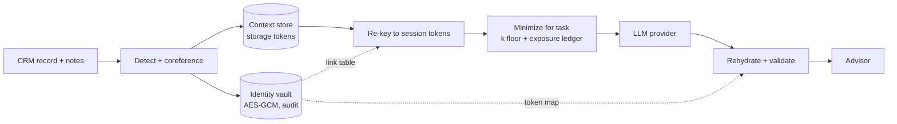

# secure-context

Giving AI client context without exposing client data (DSI industry project p040 with LPL Financial).

An advisor's AI assistant is more useful when it knows the client's goals, holdings and history, but sending the full client file to a model provider exposes far more than the task needs. This repo builds and evaluates a privacy-preserving context layer:

1. **Detect** identifiers in structured fields and free-text advisor notes.
2. **Split storage**: identity in an encrypted vault, financial context in a separate store, joined only through a link table inside the vault (random UUID keys, so primary keys reveal nothing).
3. **Dehydrate**: replace identifiers with session-keyed HMAC tokens. Tokens change every session, so AI logs cannot be linked across sessions.
4. **Minimize**: for each task, send only the detail it needs (age band instead of age, sector weights instead of tickers). The adaptive minimizer searches, per client, for the most useful context whose crowd size k stays above a floor.
5. **Track cumulative exposure**: a ledger merges everything already revealed about a client, because a provider can link requests by content even when tokens rotate.
6. **Rehydrate** the model's answer for the advisor and flag tokens it cannot resolve.
7. **Attack it**: key lookups, cross-session linkage, hash brute force, quasi-identifier linkage against a 50,000-person directory, attribute inference, and extraction of a planted proprietary strategy.

All data is synthetic and generated from a fixed seed.

## Headline results

| | Masking only | Task policy | Adaptive + ledger |
|---|---|---|---|
| Clients unique after one request (meeting brief) | 100% | 0.7% | 0% |
| Clients with k < 10 after one income-plan request | 100% | 47% | 0% |
| Clients unique after 12 mixed requests | n/a | 61% | 0% |
| Mean task utility after 12 requests | 1.00 | 1.00 | 0.89 |

* Masking names and account numbers leaves every client unique: exact age, city, occupation, assets and top holding match one person in the directory.
* Fixed per-task policies look safe one request at a time, but exposure compounds. After 12 requests 61% of clients are unique again. The exposure ledger keeps everyone at k of 10 or more for an 11% utility cost.
* Split storage with HMAC tokens blocked every key-based attack. A plain SHA-256 of the SSN as a key was recovered by brute force.
* Rule-based PII detection scores 100% on notes written in expected formats but leaks in every note of a harder stress set (best recall 57%). This is the case for adding GLiNER.
* Coarse answers (rounded allocations, hidden rule outputs) kept the planted strategy's thresholds at chance level after 2,000 attacker queries, at a cost of 2.2 points of allocation precision for honest users.

Full method and numbers: [docs/EVALUATION.md](docs/EVALUATION.md).

## Try it

```bash
pip install -r requirements.txt
streamlit run app/streamlit_app.py          # interactive demo
python eval/run_all.py --no-presidio         # full evaluation (add Presidio: pip install -r requirements-optional.txt)
pytest -q
```

A static walkthrough that needs no Python is in [`prototype/index.html`](prototype/index.html). Deployment options are in [docs/DEPLOY.md](docs/DEPLOY.md).

## Layout

```
secure_context/
  data.py        synthetic population, client book, advisor notes with ground-truth spans, stress notes
  detect.py      regex, CRM dictionary, Presidio and GLiNER detectors; coreference to canonical values
  vault.py       identity vault (AES-GCM, audit log) + context store, role checks, session re-keying
  tokens.py      HMAC session tokens, dehydrate, rehydrate with safe repair
  policy.py      fields, generalization levels, task policies
  privacy.py     crowd-size engine, exposure ledger, adaptive policy search
  tasks.py       prompts, reference task engine, utility scoring
  attacks.py     key-based attacks, attribute inference
  strategy.py    planted proprietary strategy, extraction attack, defenses
  dp.py          Laplace-mechanism cohort statistics and a differencing attack
  llm.py         simulated, Anthropic and OpenAI backends
  pipeline.py    one request end to end, with timings
eval/run_all.py  every experiment; writes eval/results/*.csv and eval/figures/*.png
eval/llm_eval.py optional: LLM-judged answer quality and an LLM attacker (needs an API key)
app/             Streamlit app
prototype/       static HTML walkthrough
tests/           pytest suite
```

## Architecture



## References

NIST IR 8053 (de-identification), NIST SP 800-226 (differential privacy), MINIM (trusted local sanitization), RAGFort (knowledge-base extraction defense), arXiv 2510.03662 (data minimization for LLM prompting), SEC Regulation S-P.
