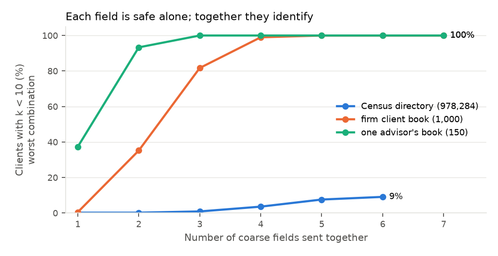
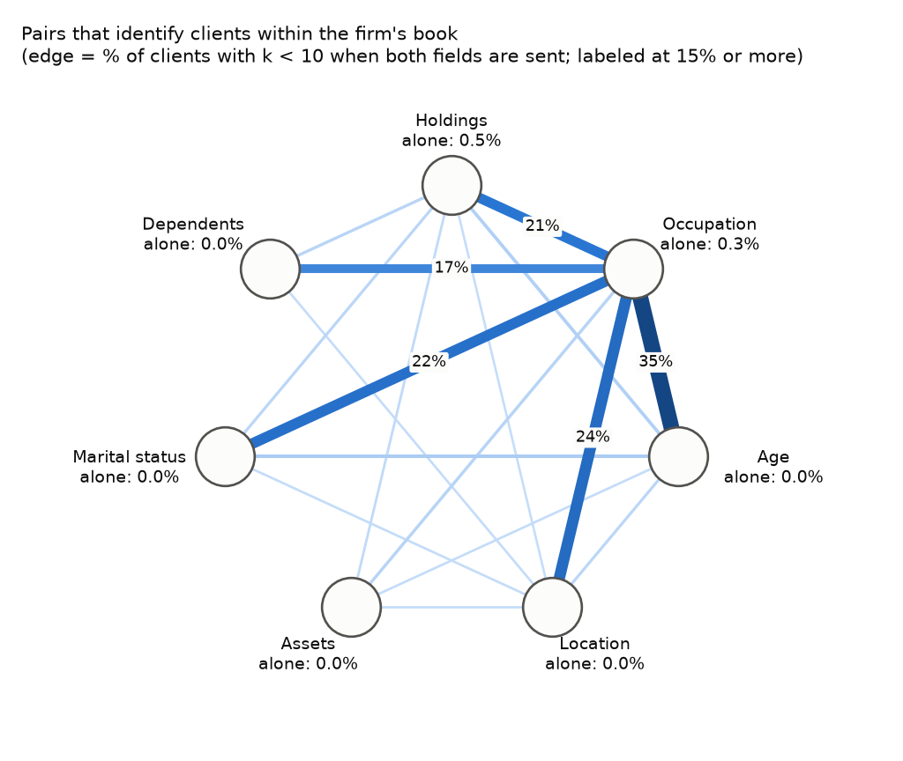
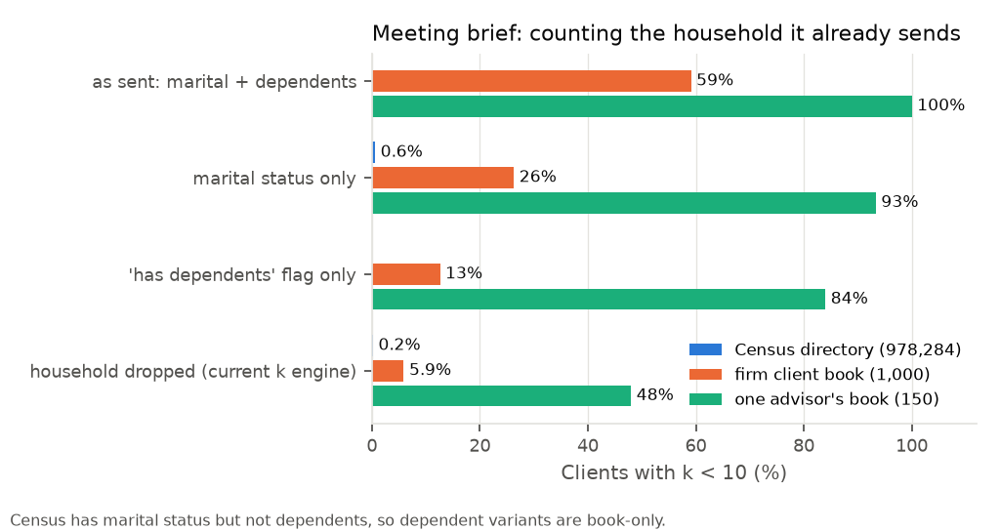

# Combination risk: harmless alone, identifying together

This builds on the crowd-size engine (`privacy.KEngine`). The engine answers "is this policy safe for this client?". This analysis maps which **combinations** of fields are dangerous, so we know what never to send together, and it checks two gaps in how k is computed today.

```bash
python3 eval/run_combinations.py   # under a minute; writes eval/results_real/combinations_*.csv and eval/figures_real/combinations_*.png
```

Code: `secure_context/combinations.py`. Tests: `tests/test_combinations.py`.

**Data.** The full public-data environment: 978,284 Census adults and 1,000 Financial-Advisory clients, with each client's portfolio mix matched to their assets (PR #9). Without `scripts/download_data.py` the script falls back to the committed 150K sample, which gives harsher Census-level figures.

**Consistency check.** For the meeting brief's fields, this engine and `KEngine` give the same k for 100% of clients. The occupation-inference result below also agrees with `attribute_inference` (21% vs. a 13% baseline here, compared with 14–23% vs. 13% there).

## 1. Every field is safe alone; together they identify

We computed k for **every subset** of the quasi-identifiers: age, location, occupation, assets, holdings, marital status, and (for the firm's book) dependents. Each is taken at the coarse level that task policies actually send: age band, region, occupation group, asset bucket, and sector mix. The table shows the worst subset of each size, as % of clients with k < 10.

| Fields combined | Census (978K) | Firm book (1,000) | One advisor's book (150) |
|---|---|---|---|
| 1 | 0.2% | 0.5% | 37% |
| 2 | 0.2% | 35% | 93% |
| 3 | 0.9% | 82% | 100% |
| 4 | 3.6% | 99% | 100% |
| all | 9.1% | 100% | 100% |



- **Census.** No single coarse field or pair is risky, but all six coarse fields together put 9.1% of clients below k = 10.
- **Fine levels.** At the levels masking sends (exact age, local area, exact occupation), **local area + occupation alone** puts 58.5% of clients below k = 10, and any four exact fields put essentially everyone there.
- **The firm's book.** Any outsider who knows someone is an LPL client compares against the book, not against Census. There, **two coarse fields are already enough**.

### The network: which pairs are dangerous



Within the firm's book, every field is at most 0.5% risky alone, but some pairs are not:

| Pair | % of clients with k < 10 |
|---|---|
| Age band + occupation group | 35% |
| Region + occupation group | 24% |
| Occupation + marital status | 22% |
| Occupation + holdings mix | 21% |
| Occupation + dependents | 17% |

Occupation is the hub. Any request combining it with almost anything else is risky inside the firm.

### Smallest identifying sets

For every client, we found the smallest field combinations that already make them identifiable.

| | Every client has one? | Smallest set size |
|---|---|---|
| Firm book | yes, 100% | 2 fields for 56% of clients, 3 fields for 41% |
| Census | 9% of clients | 4–5 fields for most of them |

The most common minimal sets in the book are `age + location + occupation` (40% of clients), `location + occupation + dependents` (36%), `age + occupation + dependents` (35%) and `age + occupation` (35%). This list is a ready-made **deny list of combinations** for the task policies.

Files: `combinations_risk.csv` (all subsets), `combinations_pairs.csv`, `combinations_minimal_sets.csv`, `combinations_by_size.csv`.

## 2. Gap: the household field isn't counted in k (fixed)

**Status:** fixed. `household` is now a quasi-identifier with levels `exact` / `has_dependents` / `drop`. `KEngine` matches it on whatever the reference population records (Census: marital status; the firm's book: marital status and dependents), and `run_real.py` was rerun. After the portfolio fix (PR #9) and a rerun on the full data, meeting brief, firm book: 5.9% to 59.1% with k < 10; one advisor's book: 48% to 100%. The adaptive policy still holds 0% against Census, choosing "has dependents" where needed, at the same utility (0.9995). The table below is the analysis that found the gap, rerun on the same data.

The meeting-brief policy sends `household="exact"`, which renders as "Married, 2 dependents". But `household` is not marked as a quasi-identifier in `policy.FIELDS`, so `KEngine` (and with it the adaptive policy and the exposure ledger) ignores it. Census has marital status. The firm also knows dependents, and any insider or a vendor serving the firm has the book.

Meeting brief, % of clients with k < 10:

| Household sent as | Census (978K) | Firm book (1,000) | One advisor's book (150) |
|---|---|---|---|
| Not counted (the k engine before the fix) | 0.2% | 5.9% | 48% |
| **As sent: marital + dependents** | n/a | **59%** | **100%** |
| Marital status only | 0.6% | 26% | 93% |
| "Has dependents" flag only | n/a | 13% | 84% |

"n/a" means Census has no dependents field, so an outside attacker can't match on it.



The first row reproduces the pre-fix `reference_population.csv` figures, and the bold row matches `KEngine` after the fix (59.1%). Counting what the brief actually sends multiplies the firm-book figure by 10.

**Proposed fix (for discussion):**
1. Mark `household` as a quasi-identifier in `policy.FIELDS`, with levels `exact` / `has_dependents` / `drop`.
2. Add `marital` to the `KEngine` signatures. The directory already has it from Census `MAR`.
3. Rerun `run_real.py`. The adaptive policy will then choose the coarser household level when needed, which costs at most the one "Household and beneficiaries" agenda item (1 of 8–9 items in the meeting-brief utility).

## 3. Gap: k ≥ 10 can still reveal a withheld attribute

k counts how many people match. It doesn't check whether those people **all share the same hidden value**. If the 40 people matching a client are all in the top income band, the attacker learns the income without identifying the client. The standard fixes are l-diversity and t-closeness.

Among clients whose k is already ≥ 10 against Census, this is how often the crowd's most common value is the client's real value with at least 80% confidence:

| Sent | Withheld attribute | Disclosed despite k ≥ 10 | Attacker accuracy vs. baseline |
|---|---|---|---|
| Meeting brief (age band, assets, sector mix) | occupation group | 3.4% | 21% vs. 13% |
| Meeting brief | income band | 2.0% | 37% vs. 32% |
| Five coarse fields | income band | 4.8% | 37% vs. 32% |
| Concentration check (assets, holdings) | any | 0% | near baseline |

The effect is small on this data, but it is invisible to the k floor. The directory's wealth comes from a statistical match to the SCF, which likely understates how strongly real assets track income and occupation. With LPL data we would expect this to be larger. File: `combinations_homogeneity.csv`.

**Proposed fix:** add a second check next to the k floor. Within the matching crowd, no withheld sensitive attribute (income band, occupation group, asset bucket) may have one value above a set share, for example 80%.

## 4. Which fields predict hidden ones

`combinations_inference.csv` gives, for every pair of attributes, the share of uncertainty about one that knowing the other removes (normalized mutual information). The non-trivial links:
- region → state: 76%
- holdings mix → asset bucket: 18%
- occupation → income band: 13%
- age → marital status: 13%

These are the edges an inference attacker uses. They suggest which withheld fields need the crowd-homogeneity check.

## How to defend against reconstruction

1. **Count every field that's sent.** Household now; free-text mentions are already handled by `KEngine.effective`.
2. **Set the k floor against the firm's own book,** not Census. This analysis shows two coarse fields suffice inside the book.
3. **Keep a combination deny list from the minimal sets,** for example "never send age band with occupation group". It's cheap to check before the k search and easy for compliance to read.
4. **Add the crowd-homogeneity check** next to the k floor.
5. **Keep the ledger.** Combinations also form across requests: two safe requests that each send one field of a dangerous pair are caught only by the ledger, which already handles this.

## Limitations

- Census person records have marital status but not dependents, so the dependents risk is shown against the firm's book only.
- Wealth and portfolio data are statistically matched, which weakens inference links between financial fields and demographics.
- k is an unweighted count of directory records, consistent with `KEngine` as used in `run_real.py`.
